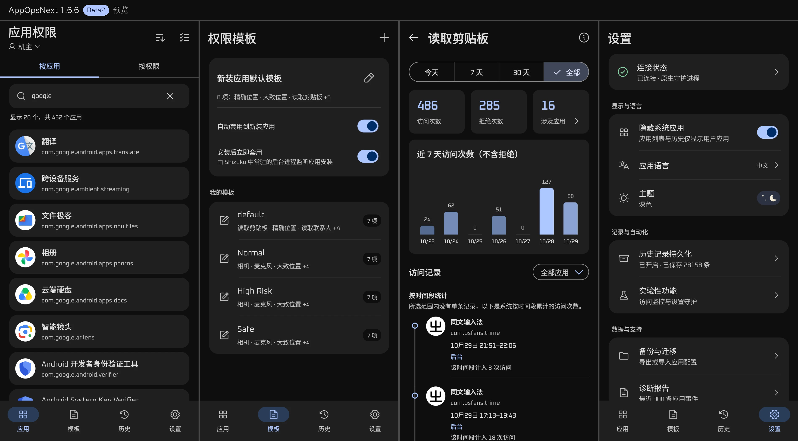

# AppOpsNext

[English](README.md) | **简体中文**

AppOpsNext 借助 [Shizuku](https://shizuku.rikka.app/) 管理应用的 AppOps 设置、查看权限历史，并监测指定权限的访问，无需 root。它主要用于回答四个问题：

* **配置：** 我允许了什么？
* **事件：** 谁在访问什么？
* **结果：** 系统最终是允许还是拒绝？
* **观察者：** 还有谁在监听这些变化？

[下载 APK](https://github.com/1zumiii/AppOpsNext/releases/latest) ·
[反馈问题](https://github.com/1zumiii/AppOpsNext/issues) ·
[构建状态](https://github.com/1zumiii/AppOpsNext/actions/workflows/ci.yml)

**官方 APK 只在 GitHub Releases 发布**，不对从其他第三方渠道下载的安装包作任何保证。

## 界面预览

[](docs/Preview-zh.png)

## 功能特点

- **权限控制：** 分别设置应用的相机、定位和剪贴板等 AppOps，修改后回读核对。
- **模板：** 把常用限制存为模板，批量套用，也可自动套用到新装应用。
- **权限历史：** 按时间和应用筛选历史，并统计拒绝次数。开启持久化后，可在本机保留超过 7 天的单条记录。
- **访问监测（实验性）：** 监测指定应用的权限访问，通报允许或拒绝结果，并留存记录。
- **权限变更监听者（实验性）：** 查看哪些进程正在监听权限设置的变化。
- **特权操作范围：** 只使用固定的 AppOps 和权限标记命令，不执行任意 shell 命令。记录保存在本机，仅检查更新时联网。

## 主要功能

| 功能 | 说明 |
| --- | --- |
| 应用列表 | 浏览当前用户的应用，按名称或包名搜索，可选择是否显示系统应用。也可切换到“按权限查看”，列出各应用对同一项权限的模式，并直接修改。 |
| AppOps 管理 | 查看应用按包和按 UID 两种范围的模式，修改后自动校验。 |
| 模板与批量操作 | 创建可复用的规则并调整顺序，把模板套用到多个应用上，或一次修改一个应用的多项权限。多选时可全选当前显示的项目，执行前列出目标模式和待修改项目。 |
| 新装应用 | 可选择自动套用模板，补充处理尚未完成的安装，并查看每条规则的执行结果。 |
| 权限历史 | 查看权限使用分布、应用统计和时间线，支持按时间范围和应用筛选，可自选要查看的权限并排序。也可将单条记录保留 7 天以上。 |
| 设置与诊断 | 语言可选简体中文、英文或跟随系统。可查看连接状态和诊断报告。有新版本时不弹窗提示，也不强制更新。 |
| 实验性功能 | 监测指定应用的指定权限，记录访问并按规则通知。每个监测点可单独设置通报间隔、提醒方式、访问结果筛选，以及是否只在应用不在屏幕上时通报。开启时会检查系统监听注册，监测记录可供查询。 |

## 安装与上手

### 运行要求

- **Android 15 及以上**（API 35+）。
- **Shizuku 13 及以上**，已启动并授权给 AppOpsNext。
- 内置的原生后端仅支持 ARM64，其他 CPU 架构尚未验证。

通过 ADB 或无线调试启动 Shizuku 时无需 root，但 AppOpsNext 的特权操作始终依赖 Shizuku。

1. 安装并启动 [Shizuku](https://shizuku.rikka.app/)。
2. 在 [最新 Release](https://github.com/1zumiii/AppOpsNext/releases/latest) 下载 APK 并安装。
3. 打开 AppOpsNext，在 Shizuku 弹出的授权请求中选择“允许”。
4. 选择应用和权限，核对确认信息后再修改。

可复用的规则在“模板”页配置，系统记录在“历史”页查看。新装应用自动套用模板默认关闭，须先配置规则再开启。

更新时覆盖安装新版 APK 即可，设置均会保留。设备重启后 Shizuku 未运行或授权被撤销时，须先恢复连接，才能读取或修改系统状态。已保存的历史记录不受影响，仍可查看。

### 已验证的设备

| 设备 | 系统 | 验证范围 |
| --- | --- | --- |
| ASUS AI2302 | Android 15 / API 35 | 主要的开发和真机测试设备。 |
| Xiaomi 24117RN76G | HyperOS 3 / Android 16 / API 36 | 由用户独立验证了原生后端、读取与写入、权限历史和相机权限限制。 |
| realme RMX3370 | Android 16 / API 36 | 由用户独立验证：兼容撤销标记可使“忽略”生效。 |

以上结果仅说明这些设备经过测试，不代表兼容所有厂商的 ROM。具体依据和已知限制见[后端兼容性说明](docs/PRIVILEGED_BACKENDS.md)。

## 历史记录从哪里来

历史数据来自 Android 系统的权限访问记录。有单条访问记录的权限，AppOpsNext 优先显示单条记录。剪贴板等没有单条记录的权限，显示系统按时间段累计的次数。记录的保留时长和时间精度均由设备决定，因此这些数据不是完整的审计日志。

- 每项权限最近一次成功读取的结果留存本地，重新打开应用时直接显示，并标明更新时间。
- 5 分钟内回到页面时，沿用现有记录。记录已过期或权限尚未读取时，须同时满足三个条件才会读取：历史页正在显示、应用在前台、后端已连接。定时刷新遵循相同的条件。
- 手动刷新不检查记录是否过期，始终重新读取，每项权限读完后立即更新。读取失败时保留上一次的结果，并显示错误提示。
- 首次读取成功之前，页面会区分“尚未读取”和“没有记录”。

这部分本地记录仅是最近一次读取的缓存，存放在应用私有目录下，不参与 Android 备份。清除应用数据或卸载应用后，缓存随之删除。

### 历史记录持久化

系统只保留最近 7 天的单条访问记录。更早的访问只保留按时间段累计的次数，没有具体时间。在设置中开启“历史记录持久化”后，AppOpsNext 会把所选权限的单条记录另存到本地。可选的权限为相机、麦克风、精确位置和大致位置，系统仅对这些权限提供单条记录。

- 首次开启时，默认勾选历史页已选的权限。此后两处的选择各自独立。
- 历史页上显示的权限在刷新时一并保存。其他已勾选的权限在打开应用时补存，最多每 6 小时一次。读取和写入正常时，每 7 天内至少打开一次应用，可避免单条记录因过期而出现缺口。
- 未保存的时段，使用 30 天内的时间段统计补齐。时间段与已保存的记录重叠时，只计入记录未覆盖的访问。系统有时会把多次访问合并为一条记录，因此该数字可能略高于实际次数。
- 最多保存 10 万条，达到上限后先删除最早的记录。记录仅保存在本地，不参与备份，可按日期范围或全部删除。
- 存档文件无法读取时（例如降级安装了旧版本），AppOpsNext 不会覆盖该文件，而是暂停保存，直到删除该文件。

系统不会为被拒绝的访问留下单条记录。如需逐条查看，请使用实验性功能中的访问监测，并在“监测记录”中查询。

## 修改 AppOps 之前的须知

**AppOps 和 Android 运行时权限是不同的。** 应用未获得某项运行时权限（例如相机权限）时，把对应的 AppOp 设为“允许”也不会使其获得该权限。Android 或厂商的策略还可能改写甚至拒绝所设置的模式。遇到运行时权限导致的失败，AppOpsNext 会说明原因，并提供跳转到该应用系统设置的入口。

部分 Android 16 设备会限制相机、麦克风和位置等运行时权限的 AppOps 修改。遇到此类限制时，AppOpsNext 通过设置兼容撤销标记（REVOKED_COMPAT）实现“忽略”。这种方式保留应用已获得的权限，不会结束应用进程，系统权限页面可能仍显示为“已允许”。在此类设备上，受影响的权限不支持“拒绝”，选择“拒绝”时会自动改用“忽略”。

AppOpsNext 按以下流程修改并核对：

```text
读取并确认原来的状态
  → 写入新的模式
  → 回读校验
  → 失败时尝试恢复原来的状态，并核对是否改回
```

手动修改、批量操作和自动套用模板共用同一个队列，一次只执行一项。命令执行完毕不代表修改成功，核对和恢复的结果会分别报告。失败后的恢复仅为尽力补救，不保证成功。

按 UID 修改可能同时影响共用该 UID 的多个应用，确认界面会列出这些应用。自动切换修改范围也受到限制，避免在未告知的情况下扩大影响范围。批量操作会逐项报告每个应用的结果。

## 使用到的权限和网络

| 权限 | 用途 |
| --- | --- |
| `QUERY_ALL_PACKAGES` | 管理 AppOps 需要查询设备上所有的应用。 |
| `INTERNET` | 仅用于检查新版本。 |
| `POST_NOTIFICATIONS` | 通知新装应用自动套用模板的结果，以及实验性访问监测的实时推送。 |
| `FOREGROUND_SERVICE`、`FOREGROUND_SERVICE_SPECIAL_USE` | 访问监测开启期间保持在后台运行，确保能收到系统的回调。 |

检查更新仅访问一个 GitHub 公开接口，不发送其他请求。该功能不强制更新，不自动下载或安装任何内容，也不弹窗或发送通知。有新版本时，仅在设置页的“应用版本”旁显示。**不会上传任何用户数据。**

诊断报告不会自动发送到任何地方。报告仅在设备上生成，只有手动复制时才会写入剪贴板。

## 常见问题

- **无法连接：** 确认 Shizuku 正在运行并已授权 AppOpsNext，再在“设置 → 连接与诊断”中查看详情。应用首选内置的原生后端，启动失败时自动改用 Shizuku UserService。
- **设置的模式未生效：** 查看对应的 Android 运行时权限和回读核对的结果。部分系统限制无法通过 AppOps 修改。部分 Android 16 设备上的运行时权限只能设为“忽略”，详见“修改 AppOps 之前的须知”。
- **历史记录过旧或不完整：** 查看更新时间，尝试手动刷新，并确认后端已连接。可读取的记录范围可能因 ROM 而异。
- **访问监测始终没有提示：** 访问监测是实验性功能，依赖设备对特权接口的支持。关闭后重新开启，查看自检结果。无法确认系统监听注册时，原因可能是格式不受支持，也可能是监听缺失，不能仅凭自检结果判断设备是否支持。此外，须确认已选择至少一个监测点、已授予通知权限，并已开启监测通知类别。
- **监测计数与应用实际调用次数不一致：** 计数是通报的次数。Android 可能为一次调用报告多个事件。监测点设置了通报间隔时，间隔内的访问不会通报。计数仅包含当前用户空间中选中的应用，监测结果也不是精确的 API 调用记录。
- **高频权限产生大量通知：** 定位等权限可能频繁上报访问。未设置通报间隔时，短时间内可能收到大量通知。可在“设置 → 实验性功能 → 监测设置 → 监测点设置”中为该监测点设置通报间隔。
- **开启“仅在应用不在屏幕上时通报”后，仍通报屏幕上可见的访问：** 判断依据是 AppOps 记录的进程状态。只有应用正显示在屏幕上时才算作前台，前台服务不算。完全无法读取该状态时，访问会照常通报。
- **强行停止 AppOpsNext 后监测停止工作：** 强行停止会移除监测服务，系统也不会自动重启该服务。开关保持开启时，重新打开 AppOpsNext 即可恢复。
- **熄屏一段时间后监测停止：** 部分厂商的电池优化或后台管理会结束应用进程，前台服务也无法阻止。如需长时间监测，请在系统设置中将 AppOpsNext 排除出电池优化，并在最近任务中锁定。重新打开应用会自动恢复监测。
- **反馈问题：** 请附上设备型号、Android / ROM 版本、复现步骤，以及设置页中的诊断报告。公开提交 Issue 之前，建议先检查日志，删除不希望公开的敏感信息。

## 从源码构建

构建需要 JDK 17、Go 1.24 及以上版本，以及已安装 Platform 36 的 Android SDK。仓库自带 Gradle Wrapper。将 `JAVA_HOME` 指向 JDK 17，SDK 路径通过 `local.properties` 中的 `sdk.dir` 或环境变量 `ANDROID_HOME` 指定。

```shell
# 可选：Go 不在 PATH 里时，指定它的绝对路径。
# export GO_EXECUTABLE="/absolute/path/to/go"

./gradlew :app:assembleDebug
```

构建产物位于 `app/build/outputs/apk/debug/app-debug.apk`。Gradle 会同时为 Android ARM64 交叉编译内置的守护进程，无须另外使用 NDK 构建。Debug 版在应用处于前台时保持屏幕常亮，签名也与公开发布的 Release 版不同。

执行与 [Android CI](.github/workflows/ci.yml) 相同的检查：

```shell
(cd daemon && "${GO_EXECUTABLE:-go}" test ./...)
./gradlew :app:testDebugUnitTest :app:lintDebug :app:assembleDebug --no-daemon
```

### 签名的 Release 构建

公开发布版的签名文件不在 Git 仓库中。Release 构建需要 `.signing/appopsnext-release.keystore`，密钥别名为 `appopsnext`，并须在环境变量中设置 `APPOPSNEXT_STORE_PASSWORD` 和 `APPOPSNEXT_KEY_PASSWORD`：

```shell
./gradlew :app:assembleRelease
```

构建产物位于 `app/build/outputs/apk/release/app-release.apk`。分发时请使用自己的密钥库。覆盖安装已有版本时，签名必须一致。维护者的验证和发布流程见[发布检查清单](docs/RELEASE.md)。

## 代码与文档

Android 代码位于 `app/src/main/java/dev/izumi/appopsnext/`。

| 路径 | 职责 |
| --- | --- |
| `presentation/` | Compose 界面、ViewModel 和界面状态。 |
| `appops/` | 命令、解析、修改范围的处理，以及带校验的写入流程。 |
| `nativebackend/`、`shizuku/` | 特权连接、原生管道和 UserService 备用方案。 |
| `apps/`、`settings/` | 应用发现、元数据缓存和用户设置。 |
| `templates/`、`newapps/`、`batch/` | 模板存储、新装应用检测、可中断续跑的规则执行，以及批量操作。 |
| `history/` | 系统历史的解析、刷新调度、本地缓存和单条记录存档。 |
| `diagnostics/` | 环境和连接报告。 |
| `monitor/` | 实验性功能访问监测：通过转发的 binder 调用注册监听、各监测点的通报设置、事件过滤、通知和监测记录。 |
| `update/` | 通过 GitHub API 检查新版本并比较版本号。 |
| 仓库根目录的 [`daemon/`](daemon/) | 使用 Go 编写的守护进程，仅接受白名单中的命令。 |

延伸阅读：[架构说明](docs/ARCHITECTURE.md) · [特权后端](docs/PRIVILEGED_BACKENDS.md) · [设备验证记录](docs/DEVICE_FINDINGS.md) · [发布检查清单](docs/RELEASE.md)。

## 授权协议

AppOpsNext 是自由软件。可依据自由软件基金会发布的 GNU 通用公共许可证第 3 版，或（自行选择）任何更新的版本，重新分发和修改本软件。

分发本程序是希望它能派上用场，但**不附带任何担保**，甚至不包含适销性或特定用途适用性的默示担保。详见 [GNU 通用公共许可证](LICENSE)。

Copyright (C) 2026 1zumiii.

第三方组件保留各自的授权：Shizuku API 和 Phosphor Icons 为 MIT，AndroidX 与 Jetpack Compose 为 Apache-2.0，均与 GPL-3.0 兼容。Phosphor 的许可声明位于 `app/src/main/assets/licenses/phosphor-icons.txt`。

## 项目背景

AppOpsNext 借鉴了旧版 App Ops（`rikka.appops`）的产品思路和使用流程，但代码为从零独立实现（clean-room）。它不是旧版的 fork、移植、修改版，也不是官方续作。

项目中没有旧版应用的源码、反编译代码、资源、品牌素材或配置数据，不依赖旧版应用，也不提供从旧版迁移配置的功能。

AppOpsNext 与 RikkaApps 以及旧版 App Ops 的作者之间没有开发、背书或支持关系，使用 Shizuku 也不代表与其维护者存在从属关系。名称中的“AppOps”指 Android 内置的同名系统服务。
